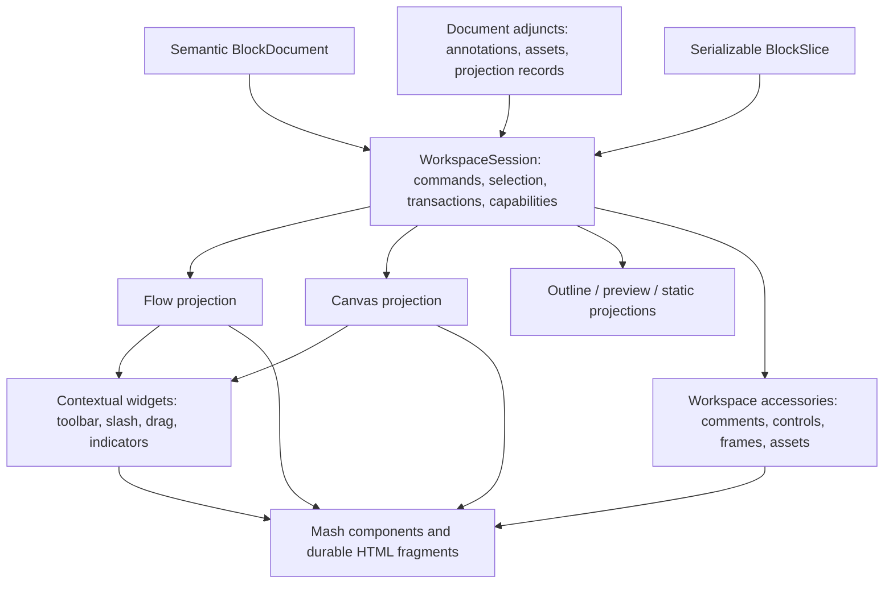

# Document Workspace Architecture

This document turns the BlockSuite reference audit into a Mash-native target for
document, canvas, and inspector experiences. It defines ownership and
composition boundaries. It does not select a persistence engine, collaboration
runtime, rich-text engine, or final workspace UX.

The companion
[`blocksuite-reference-taxonomy.md`](blocksuite-reference-taxonomy.md) records
the reference implementation and its pressure points. This document records
what Mash should build from those findings.

## Reference Coverage

The audit covers the public BlockSuite component, framework, blog, and generated
API documentation, plus the local checkout at commit
`5cb5cb68471ca692f3c162258f0087cb22fcb82d` (2025-07-07).

The local documentation corpus contains 104 Markdown or MDX files:

- 47 narrative pages under `docs`, including all 17 framework guides, all 26
  component pages, and both substantive blog articles;
- 44 generated API pages under `packages/docs/api`;
- package and repository READMEs covering the framework, store,
  synchronization, extension loader, playground, integration tests, and
  development workflow.

The public pass also inventories all 70 published API package entry pages. The
public API is broader than the generated pages in this checkout, so current
package presence was checked on the site while behavioral claims were verified
against readable local implementation source.

The source trace additionally covers the framework store and std packages,
AFFiNE extension bundles, every fragment package, the playground comment app,
the drag-handle widget, the surface renderer, and the GFX viewport, layer,
selection, hit-test, and interaction managers. The public component sidebar
omits the local pie-menu page, while several public fragment pages describe
packages that are not present in this checkout. Source is therefore
authoritative where the prose and package graph disagree.

## Core Conclusion

Mash should not become a BlockSuite-compatible editor kernel. It should provide
a smaller renderer-neutral document contract whose records can be projected
through Mash components, native HTML, static Foil markup, a flow editor, an
edgeless scene, or another renderer.

The strongest transferable ideas are:

1. The document outlives every editor and panel.
2. One semantic block can have multiple view-specific realizations.
3. Selection and commands are normalized context, not toolbar-local state.
4. Clipboard and drag use a serializable slice rather than moving live DOM.
5. External document UI has an independent lifecycle.
6. Edgeless rendering interleaves graphical and DOM-backed content under one
   geometry, ordering, and hit-test system.
7. Feature assemblies are explicit contribution profiles, not hidden import
   order.

Mash already has the beginnings of this grammar in `BlockCatalogue`,
`BlockDocument`, `CommandRegistry`, `SelectionManager`, `DragController`,
component integration roles, and the editing playground. The next work is to
connect those contracts without making leaf components aware of a document
store.



## Current Mash Pressure Points

The current pieces are intentionally not yet a cohesive editor runtime:

- `ui-editor` is a source/code text control. It must not be overloaded into the
  future document workspace host merely because its tag contains "editor."
- `BlockNode.children` currently nests records, while an older host sketch in
  the reference taxonomy uses child IDs. A v2 protocol must choose and version
  one public snapshot shape instead of accepting both implicitly.
- `BlockDefinition.components` and the separate component integration-role maps
  can drift because they have different sources of truth.
- `SelectionManager` can hold a live browser `Range`; that is useful view state
  but is not a serializable selection anchor.
- `CommandRegistry` is reusable, but command presentation and projection are
  still assembled locally in examples.
- The shared overlay implementation is capable, but virtual rectangle and point
  anchors are not yet a public contract.
- `ui-draggable` supplies movement geometry, not payloads, drop targets, reorder
  semantics, keyboard movement, or announcements.
- The editing playground mutates DOM, uses native drag reorder, manually places
  toolbars, and records `innerHTML` history. It is a valuable integration
  fixture, not the final document adapter.
- File selection and image rendering have clean owners; ingestion, durable asset
  IDs, upload progress, media resolution, and object-URL lifetime still need a
  host capability.
- Comments are currently authored example markup, not an annotation/thread
  contract.

These are connection points for adapters and registries, not evidence that Mash
needs a monolithic `ui-block-editor`.

## Vocabulary Firewall

These terms describe different contracts and must not be used interchangeably.

| Term                   | Mash meaning                                              | Owns                                                                | Does not own                                                    |
| ---------------------- | --------------------------------------------------------- | ------------------------------------------------------------------- | --------------------------------------------------------------- |
| Block record           | Versioned, renderer-neutral document node                 | Stable identity, type, JSON props, ordered children                 | DOM, Lit templates, focus, geometry, services                   |
| Block definition       | Semantic schema and catalogue metadata for one block type | Defaults, validation, migration, capabilities, discovery            | A mounted custom element or editor singleton                    |
| Block projection       | Renderer-specific realization of a block record           | View selection, rendering, measurement, focus handoff               | Canonical document state                                        |
| Durable fragment       | Authored native HTML and custom-element composition       | Readable markup, slots, semantic structure, progressive enhancement | Document session, persistence, hidden product records           |
| Contextual widget      | Transient UI bound to projection state                    | Toolbar, drag handle, slash palette, hover card, drop indicator     | Canonical content or independent document lifecycle             |
| Workspace accessory    | Independently mounted view over a document session        | Outline, comments, controls, frames, export, assets                 | Owning editor DOM or arbitrary service access                   |
| Block slice            | Serializable partial document payload                     | Clipboard, duplicate, drag, import, cross-view transfer             | Live elements, browser `Range`, file handles, service instances |
| Annotation             | Record anchored to content without becoming its child     | Comments, suggestions, references, resolved state                   | Inline presentation or panel layout                             |
| Projection state       | Durable state specific to a view of the document          | Canvas geometry, scene order, view-specific representation          | Typography tokens or transient pointer state                    |
| Session state          | Local, disposable interaction state                       | Selection, hover, active tool, viewport, open panels                | Durable document meaning                                        |
| DOM `DocumentFragment` | Native browser node container                             | Batched DOM insertion                                               | Any Mash document or fragment contract                          |

BlockSuite calls external document-bound panels "fragments." Mash reserves
fragment for durable authored markup. `WorkspaceAccessory` is the unambiguous
name for the external panel role.

## Architectural Invariants

### Document Authority

- A document can exist with zero, one, or many mounted projections.
- Unmounting a flow editor, canvas, outline, or inspector cannot destroy content
  or history.
- Mutations enter through typed operations inside a document transaction.
- History, persistence, collaboration, permissions, and asset storage remain
  host capabilities. No `ui-*` primitive imports them.

### Black-Box Components

- A custom element is a renderer, not a stored block record.
- A block adapter may set documented properties, attributes, and slots and may
  consume documented composed events.
- It must not inspect private shadow DOM or serialize a component instance.
- `custom-elements.json` and Mash semantic topology are the baseline machine
  contract. Explicit block adapters can refine behavior where generic metadata
  is insufficient.
- Structural, overlay, and behavior components remain parts of a block recipe;
  they do not become independently insertable merely because they have tags.

### Projection Independence

- The same block ID can appear in flow, canvas, outline, preview, inspector, and
  static projections.
- A projection can be replaced without migrating the semantic document.
- Projection-specific geometry and local interaction state do not leak into
  generic block props.
- Unknown block types and unavailable projections render an explicit fallback;
  they never disappear silently.

### One Action, Many Surfaces

- Command definitions remain renderer-neutral.
- Toolbars, menus, keyboard bindings, slash palettes, context menus, and
  inspectors project the same resolved commands.
- A visible control dispatches an intent or command; it does not directly mutate
  unrelated document DOM.

### Styling Boundary

- Semantic tokens style controls, typography, surfaces, elevation, motion, and
  repeated layout roles.
- CSS parts expose stable component-owned anatomy.
- Neither tokens nor parts encode block IDs, document order, selection records,
  drag payloads, history, canvas coordinates, or collaboration state.

## State Layers

The future workspace needs four explicit state layers.

| Layer             | Examples                                                              | Lifetime                  | Synchronization                                     |
| ----------------- | --------------------------------------------------------------------- | ------------------------- | --------------------------------------------------- |
| Semantic document | Block tree, properties, asset references, links                       | Document                  | Persistent and optionally collaborative             |
| Document adjuncts | Annotations, comments, named scenes, projection records               | Document                  | Persistent; policy decides what collaborators share |
| Session           | Selection, active tool, retained range, viewport, hover, pending drag | Mounted workspace session | Local by default; presence is an adapter            |
| Component         | Open, pressed, focused, invalid, loading, measured presence           | Element instance          | DOM events and public properties                    |

Canvas placement deserves a document adjunct rather than arbitrary fields on
every `BlockNode`. A block can then have both flow placement and one or more
canvas placements without pretending that `xywh` is intrinsic content. Shared
canvas layout may still be persisted and collaborative; it simply occupies a
separate, named projection-state namespace.

Viewport zoom and center are local session state unless a host explicitly saves
them as a user preference. Selection is session state. Remote selection is
presence data and never enters undo history.

A live selection and a serializable anchor are separate forms. DOM, rich-text,
table, and canvas adapters can retain engine-native objects while mounted, but
clipboard, collaboration, annotations, and history receive only stable logical
records produced by those adapters.

## Workspace Session

The integration boundary should be one narrow session assembled by the host,
not a central object injected into every leaf component. The following is a
directional contract, not a frozen API:

```ts
interface WorkspaceSession {
  readonly document: BlockDocumentAdapter;
  readonly catalogue: BlockCatalogue;
  readonly commands: CommandRegistry;
  readonly selection: SelectionManager;
  readonly projections: ProjectionRegistry;

  readonly history?: HistoryCapability;
  readonly assets?: AssetCapability;
  readonly annotations?: AnnotationCapability;
  readonly presence?: PresenceCapability;
  readonly permissions?: PermissionCapability;

  transact<Result>(
    metadata: TransactionMetadata,
    operation: () => Result | Promise<Result>,
  ): Result | Promise<Result>;

  subscribe(listener: (change: WorkspaceChange) => void): Disposable;
}
```

The session is a capability directory with explicit optional members. It is not
a generic service locator. A projection or accessory declares which
capabilities it needs, and setup fails clearly when a required capability is
absent.

Validation, ID allocation, asset preparation, and asynchronous conversion occur
before publication. The final document operation commits once against an
expected revision and emits one coherent change. An adapter that cannot keep an
asynchronous callback atomic should stage first and perform a synchronous final
commit; partial snapshot import must not masquerade as a transaction.

Leaf components continue to receive ordinary properties and authored children.
They emit composed events. A renderer/controller at the workspace boundary
translates those events into document operations.

## Registries And Contributions

BlockSuite's older `BlockSpec` usefully grouped schema, service, view, and
widgets, but that bundle also accumulated editor coupling. Mash should keep the
semantic block definition small and attach optional contributions through
registries keyed by block type and projection.

```ts
type ProjectionKind = "flow" | "canvas" | "outline" | "preview" | "static";

interface BlockProjectionContribution {
  readonly blockType: string;
  readonly projection: ProjectionKind;
  readonly renderer: string;
  readonly priority?: number;
  readonly when?: (context: ProjectionContext) => boolean;
}

interface BlockInspectorContribution {
  readonly blockType: string;
  readonly fields: readonly InspectorFieldDefinition[];
}

interface BlockCommandContribution {
  readonly blockType: string;
  readonly commands: readonly CommandDefinition[];
}
```

The actual Web projection registry can resolve a renderer tag or adapter
factory. Core records must not contain Lit templates, DOM constructors, or
callbacks. This preserves native, server, and future renderer options.

Contributions need stable IDs, explicit priority, deterministic replacement,
and a disposable registration. Import order must not decide z-order or which
command wins. Named profiles such as `flow`, `canvas`, `preview`, and `mobile`
assemble contributions without conflating profile with theme, density, or size.

The current `BlockDefinition.components` field remains a useful dependency
declaration for Web recipes. It should not become the renderer implementation.

## Projection Contracts

### Flow Projection

The flow projection maps ordered block records to readable DOM and native HTML
semantics. It owns:

- block-to-DOM realization and keyed reconciliation;
- text-engine and contenteditable integration;
- logical caret and block selection adapters;
- before, inside, and after insertion geometry;
- retained-range focus handoff for toolbars and slash palettes;
- semantic HTML and Foil export.

It does not own the canonical block records or command definitions.

### Canvas Projection

The canvas projection maps semantic blocks plus projection records into model
space. It owns:

- world-to-client coordinate conversion;
- viewport pan and zoom;
- spatial indexing and hit testing;
- fractional scene order;
- snapping, alignment, resize, rotate, and connector geometry;
- canvas-specific selection and tool adapters;
- a render-layer plan that interleaves graphical and DOM-backed nodes.

Arbitrary Mash components remain real DOM where accessibility, native input,
media, forms, or nested interaction matters. High-volume graphical primitives
can be batched onto Canvas, OffscreenCanvas, or WebGL planes. A shared scene
order creates alternating graphical batches and DOM layers so a component can
sit between shape layers without rasterizing the component itself.

The minimum plane model is:

```text
workspace chrome
interaction overlays: selection bounds, guides, cursors, drop indicators
DOM-backed block layers and batched graphical layers in scene order
canvas background and grid
```

All content planes use the same viewport transform and spatial index. Overlays
derive from model geometry and never become document children.

Off-screen DOM-backed blocks may be culled while selected or actively edited
blocks stay mounted. Coordinate adapters must distinguish model, viewport, and
browser-client coordinates and compensate for any outer CSS transform exactly
once.

Frames and groups are scene relationships, not block-tree nesting:

- a frame is a spatial/presentation region that may derive membership from
  geometry and may persist explicit membership when product semantics require
  it;
- a group is a logical, nestable association whose bounds derive from members;
- moving either emits projection-state operations over member IDs;
- neither relationship rewrites semantic parentage unless the user invokes a
  separate document-structure command.

### Outline, Preview, And Static Projections

- Outline projects hierarchy, labels, state, and reorder commands without
  mounting full block views.
- Preview uses readonly renderers and may omit editing widgets.
- Static produces durable semantic HTML with graceful custom-element fallback.
- Inspector projects selected block descriptors into fields and commands rather
  than cloning the block's rendered DOM.

## Workspace Accessories

A workspace accessory is independently mountable and subscribes to a narrow
session contract. It may survive projection replacement and can be used beside
flow, canvas, or both.

```ts
interface WorkspaceAccessoryController {
  connect(host: HTMLElement, session: WorkspaceSession): Disposable;
}
```

Expected accessories include:

- document title and metadata;
- outline and hierarchy;
- comments and activity;
- controls and selected-object properties;
- frames and presentation order;
- assets and uploads;
- adapter/export diagnostics;
- agent activity and pending output.

Accessories must not find an editor with `closest()`, query a neighboring
`editor-host`, or depend on one projection's private service scope. A workspace
shell may provide explicit context to descendants, while separately mounted
accessories receive the same session through an explicit connector. Both paths
must produce a disposable attachment.

## Block Slices And Transfer

A `BlockSlice` is the common unit for copy, duplicate, drag, import, and
cross-view transfer. It must be serializable and independently validated.

```ts
interface BlockSlice {
  readonly format: "mash-block-slice";
  readonly version: 1;
  readonly source: {
    readonly documentId: string;
    readonly projection?: string;
  };
  readonly roots: readonly BlockNode[];
  readonly selection?: readonly SerializableSelectionRecord[];
  readonly assets?: readonly AssetReference[];
  readonly projectionState?: readonly ProjectionTransferRecord[];
}
```

The slice contains records and references, never live custom elements,
`DocumentFragment`, browser `Range`, object URLs, or service instances.
Clipboard adapters can produce the Mash MIME representation plus HTML and plain
text fallbacks. Import adapters remain pure conversions around snapshots and
assets; insertion and history happen in a host transaction.

Slices are deeply copied or immutable at the boundary. Import middleware may
return a new validated slice but cannot mutate a retained source payload.

Copy and move are different policies over the same slice. Cross-document copy
allocates IDs and resolves asset references. Same-document move retains IDs and
must reject dropping into a selected descendant.

## Drag Architecture

`DragController` and `ui-draggable` remain pointer movement primitives. They
own capture, deltas, containment, autoscroll, and generic snapping. They do not
own document sorting or persistence.

A document drag adds three host layers:

1. `WorkspaceDragSession` carries a validated `BlockSlice`, operation, source
   projection, selected IDs, pointer state, and cancellation.
2. `DropTargetRegistry` asks the active projection for semantic proposals.
3. A drop transaction applies the accepted proposal once and lets every
   projection reconcile from document state.

```ts
interface DropProposal {
  readonly targetId: string | null;
  readonly relation: "before" | "inside" | "after" | "canvas" | "link";
  readonly operation: "move" | "copy" | "link";
  readonly indicator: ProjectionIndicator;
  readonly apply: readonly BlockOperation[];
}
```

The flow adapter computes before, inside, or after from DOM geometry. The canvas
adapter converts the pointer into model coordinates, performs spatial hit
testing, applies world-space snapping, and proposes projection records. The
outline adapter proposes tree relations. File drops use the browser transfer
pipeline and asset capability rather than pretending to be an internal block
move.

During movement the host renders only preview and indicator state. It does not
reparent the source DOM as the canonical mutation. Keyboard move, indent,
outdent, and arrange commands apply the same semantic operations for accessible
parity.

Do not grow `ui-draggable` into a second full application drag-and-drop engine.
The workspace layer may wrap a proven DnD transport for DOM registration,
previews, external transfer, and autoscroll, while Mash keeps the serializable
slice, semantic proposal, and transaction contracts independent of that
library.

## Comments And Controls

The current editing playground's comments rail should evolve into two
independently useful accessories presented by one small shell:

```html
<ui-tabs value="comments" label="Document side panel">
  <ui-tab slot="tab" value="comments">Comments</ui-tab>
  <ui-tab slot="tab" value="controls">Controls</ui-tab>
  <ui-tab-panel slot="panel" value="comments"><!-- accessory mount --></ui-tab-panel>
  <ui-tab-panel slot="panel" value="controls"><!-- accessory mount --></ui-tab-panel>
</ui-tabs>
```

`ui-tabs` owns tab semantics only. The workspace shell owns panel placement and
responsive presentation. The Comments and Controls accessories retain separate
lifecycle, state, and test contracts even when they share that shell.

### Comments

- Comment threads are annotation records, not children of the selected block.
- Anchors are serializable logical positions resolved by a text-engine adapter.
- Inline highlights and pins are projection decorations.
- The comments accessory consumes annotation and selection capabilities.
- A comment composer remains an authored fragment of existing input, textarea,
  button, avatar, attachment, and formatting components until its recurring
  behavior justifies a controller.

BlockSuite's playground stores Yjs relative positions directly and lets the
panel depend on `EditorHost`. Mash should preserve the resilient-anchor idea but
keep the annotation schema independent of one CRDT and one editor projection.

### Controls

- Controls resolve from the current selection and block inspector
  contributions.
- Generic Custom Elements Manifest metadata can provide a baseline field list.
- Explicit inspector descriptors provide grouping, labels, validation, units,
  conditional visibility, and multi-selection policy.
- Fields compose existing `ui-field`, `ui-input`, `ui-select`, `ui-switch`,
  `ui-slider`, `ui-color`, menu, and command primitives.
- Changes dispatch typed operations through the workspace session. The panel
  does not mutate a mounted component and treat that DOM as source of truth.

Higher-level components can expose inspector descriptors for their public
properties and stable semantic nodes. They must not expose every shadow node as
an editable part.

## Parts, Slots, And Tokens In A Workspace

High-level workspace surfaces should expose durable anatomy only:

- `header`, `tablist`, `viewport`, `footer`, and named accessory regions;
- projection roots and overlay roots where external positioning is genuinely
  required;
- stable selected, busy, readonly, and error states.

Nested components retain their own parts. A workspace shell must not re-export
every menu item, field, tab, or button part through a giant selector contract.
Authored content continues to enter through HTML slots. Runtime update streams
are channels or subscriptions, never "slots."

Use existing semantic axes:

- control size for buttons, toggles, and fields;
- density for repeated rows, trees, menus, outlines, and inspector lists;
- type presets for labels and prose;
- layout dimensions for panel and viewport constraints;
- shared elevation and presence roles for floating chrome.

Do not add canvas coordinates, panel IDs, selection colors per block type, or
drag distances as design tokens. Add workspace layout tokens only after a value
recurs across real shells; examples should begin with local semantic recipes.

## Agent-Produced Interfaces

An agent can stream document operations, not arbitrary executable markup. The
existing `BlockStreamFrame` is a good base but a production stream also needs:

- transaction or batch boundaries;
- pending, complete, failed, and cancelled block states;
- schema negotiation and migrations;
- asset declarations and deferred resolution;
- monotonic sequence and revision checks;
- unknown-block fallback;
- validation before publication;
- cancellation and rollback policy;
- provenance outside visible component props.

The host resolves every accepted record through the same block catalogue and
projection registries used for human insertion. A streamed table, form, chart,
or component-backed control is therefore inspectable, draggable, serializable,
and renderable in more than one view. Agent transport remains separate from
component behavior.

## Package Direction

No package move is required yet. The target dependency direction is:

```text
tokens -> leaf components and headless interaction primitives
      -> renderer-neutral block/command/selection contracts
      -> host document/session adapters
      -> Web flow and canvas projections
      -> workspace presets and product shells
```

The current `@mash/ui/block` export is an incubator for the renderer-neutral
record grammar. If persistence, collaboration, adapters, and projection state
grow into a substantial runtime, split that runtime into a headless package
rather than making `@mash/ui` import an editor engine.

## Implementation Sequence

### Phase 1: Vocabulary And Slice

1. Add `BlockSlice`, snapshot validation, and Mash/HTML/plain-text adapters.
2. Add migration and unknown-block fallback contracts.
3. Keep the current catalogue DOM adapter as the progressive-enhancement
   implementation.

### Phase 2: Session And Projections

1. Define the narrow `WorkspaceSession` and disposable capability interfaces.
2. Add a Web projection registry keyed by block type and projection kind.
3. Move catalogue history and mutation behind a structured document adapter.
4. Render the same fixture through flow, outline, preview, and static views.

### Phase 3: Accessories

1. Extract comments into an annotation capability and independent accessory.
2. Build the Controls accessory from selection plus inspector contributions.
3. Compose Comments and Controls through existing tabs without coupling their
   lifecycles.
4. Add title, outline, assets, and agent-activity accessories through the same
   connector contract.

### Phase 4: Semantic Drag

1. Add `WorkspaceDragSession` and `DropTargetRegistry` above `DragController`.
2. Replace editing-playground DOM reorder with slice-based transactions.
3. Add flow and outline drop adapters plus keyboard-equivalent commands.
4. Verify cross-document copy, asset references, cancellation, and rollback.

### Phase 5: Edgeless Projection

1. Add projection records, viewport transforms, spatial indexing, and
   fractional scene order.
2. Render DOM-backed Mash blocks on one scene plane.
3. Add batched graphical planes and deterministic layer interleaving.
4. Add canvas selection, move, resize, rotate, align, group, frame, connector,
   and drop adapters incrementally.
5. Reuse the same commands, slices, accessories, and block definitions across
   flow and canvas.

## Verification Matrix

The architecture is ready for broader use only when representative tests prove:

- a document survives mounting and destroying multiple projections;
- the same block record renders in flow, canvas, outline, preview, and static
  projections where supported;
- an accessory can attach, detach, and reattach without querying editor DOM;
- Comments and Controls share a tab shell while retaining independent state;
- one command definition projects through toolbar, menu, shortcut, and
  inspector;
- a block slice round-trips through Mash JSON, HTML, and plain text;
- drag proposals commit one transaction and cancel without mutation;
- a block moves between flow and canvas through projection adapters;
- unknown versions and unavailable renderers produce recoverable fallbacks;
- asset URLs and subscriptions are released on teardown;
- readonly, permission, and remote-presence updates do not enter component
  internals or local history accidentally.

Do not create an exhaustive end-to-end test for every block or toolbar item.
Use generated schema/registry tests, focused component contracts, and a small
set of cross-layer workflows that exercise the actual boundaries.

## Primary Reference Index

- [BlockSuite components overview](https://blocksuite.io/components/overview)
- [BlockSuite component types](https://blocksuite.io/guide/component-types)
- [Working with the block tree](https://blocksuite.io/guide/working-with-block-tree)
- [Selection](https://blocksuite.io/guide/selection)
- [Commands](https://blocksuite.io/guide/command)
- [Adapters](https://blocksuite.io/guide/adapter)
- [Edgeless data structure](https://blocksuite.io/components/editors/edgeless-data-structure)
- [Document-centric editor architecture](https://blocksuite.io/blog/document-centric)
- [CRDT-native data flow](https://blocksuite.io/blog/crdt-native-data-flow)
- [Generated API package index](https://blocksuite.io/api/)
- [BlockSuite source repository](https://github.com/toeverything/blocksuite)

## Explicit Non-Goals

- Reimplementing BlockSuite or depending on its MPL source by accident.
- Choosing Yjs, Automerge, ProseMirror, Lexical, or another engine inside Mash
  primitives.
- Making every `ui-*` tag independently insertable as a top-level block.
- Storing live custom elements or private shadow markup in the document.
- Treating the catalogue's current HTML snapshot history as the final store.
- Building one monolithic editor Web Component that owns document, canvas,
  comments, controls, toolbar, persistence, and collaboration.
- Finalizing Figma-, Framer-, or Notion-like visual UX before the shared record,
  projection, slice, and accessory contracts are proven.
